# NB Sound

  

  <strong>Tu propia música, reproducida, ordenada y remezclada. En tu equipo, y en ningún otro sitio.</strong>

  <a href="README.md">English</a> · <strong>Español</strong>

---

## En pocas palabras

NB Sound es un reproductor de escritorio gratuito y de código abierto para la música que ya tienes. Cataloga tus
archivos solo, completa portadas y letras, los hace sonar sin cortes y con el volumen igualado, y te da lo que ningún
servicio de streaming te da con tu propia biblioteca: un DJ privado que mezcla de verdad, karaoke de cualquier
canción, un compositor de mashups, un juego para redescubrir tu música y una aplicación de teléfono que se lo lleva
todo sin internet. Funciona **sin conexión**, **sin cuenta**, y **no envía nada** a ningún sitio salvo que enciendas
un servicio concreto. Forma parte de la suite NB Digital.

## Funciones

| Área | Qué tienes |
|---|---|
| **Reproducción** | Motor de audio propio: sin cortes, sonoridad EBU R128, ecualizador de diez bandas con 18 preselecciones, forma de onda como barra de progreso, letras sincronizadas, pantalla completa, minirreproductor y controles del sistema |
| **Biblioteca** | MP3, FLAC, M4A, OGG Vorbis y WAV; identificación, etiquetas y organización automáticas sin convertir nunca un archivo; portadas, letras e imágenes de artista; duplicados apartados; carpeta vigilada; Por revisar para lo dudoso |
| **Playlists** | Manuales, inteligentes por regla y creadas para ti con lo que escuchas |
| **Tu música** | Tu identidad musical, tu actividad, tus tops y un resumen local de escucha exportable |
| **DJ Privado** | Una sesión mezclada a partir de una frase ("algo tranquilo para concentrarme, sin reguetón"), en español, inglés o portugués, con cinco técnicas de transición |
| **DJ Mashups** | Un compositor fuera de línea que crea piezas nuevas con fragmentos de tus canciones, a tempo y en tonalidad, reproducibles y exportables a WAV |
| **Karaoke** | Separación de la voz de cualquier canción en tu propio equipo |
| **A ciegas** | Adivina tus canciones por la portada o por unos segundos de sonido |
| **Dispositivos** | Sincronización y control remoto con NB Sound Mobile por tu red local; copia a una tarjeta o un USB; Modo fiesta para que los invitados sugieran desde su navegador |
| **Agregados** | Descargas de un clic desde Ajustes: karaoke, análisis musical, pedidos al DJ en tus palabras y aceleración por GPU (Linux con NVIDIA) |
| **Interfaz** | Español, inglés y portugués, con cambio al momento; 63 temas, cinco tipografías y seis tamaños |

## Garantías de privacidad

Las hacen cumplir el código y comprobaciones automáticas, no promesas. El detalle está en
[privacidad](docs/audit/privacy.md).

* **Sin telemetría.** Ni analítica, ni informes de fallos, ni medición de uso. El registro se queda en tu disco y
  nunca contiene rutas, títulos, artistas ni claves.
* **Una sola puerta de red.** Toda conexión saliente pasa por un único módulo con un interruptor general y
  consentimiento por servicio; cualquier cliente de red fuera de él rompe la verificación.
* **Sin cuenta.** Todo funciona sin iniciar sesión.
* **Tus claves en tu llavero.** Las claves opcionales viven en el llavero del sistema.

## Capturas y video

*Un recorrido corto grabado de la aplicación real ([MP4](docs/assets/video/nb-sound-demo-es.mp4)).*

| Inicio | Biblioteca | Álbum |
|---|---|---|
| 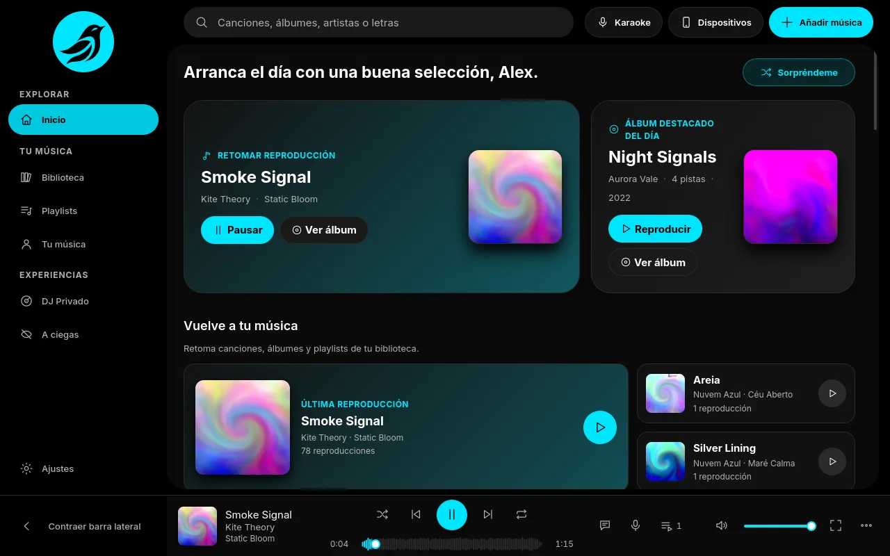 | 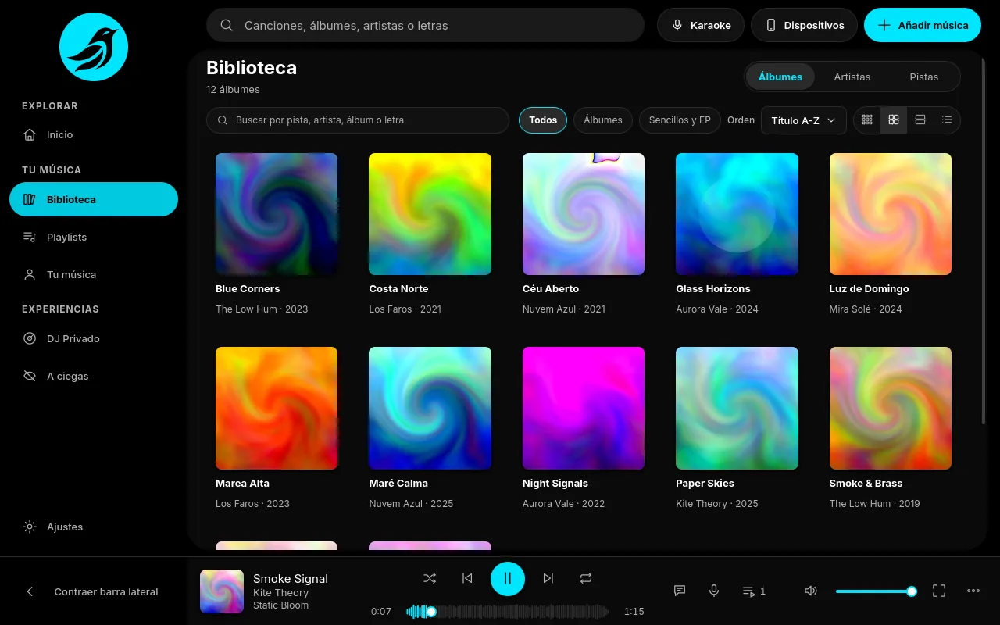 | 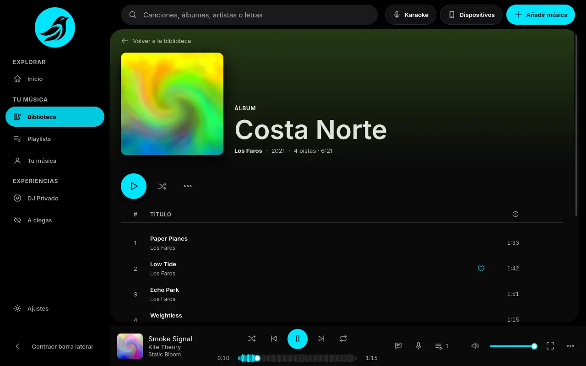 |

| Reproduciendo | Playlists | DJ Privado |
|---|---|---|
| 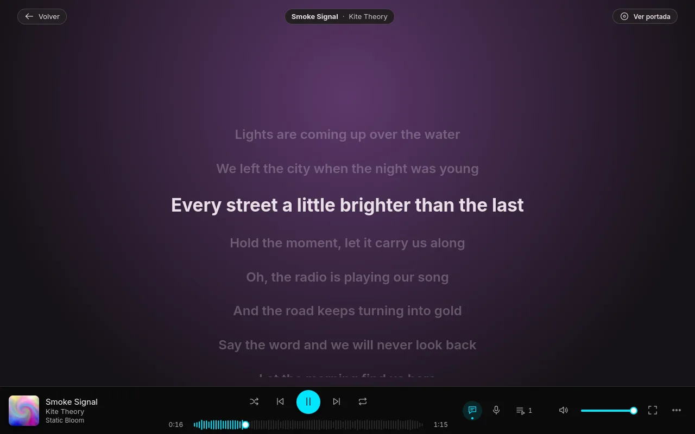 | 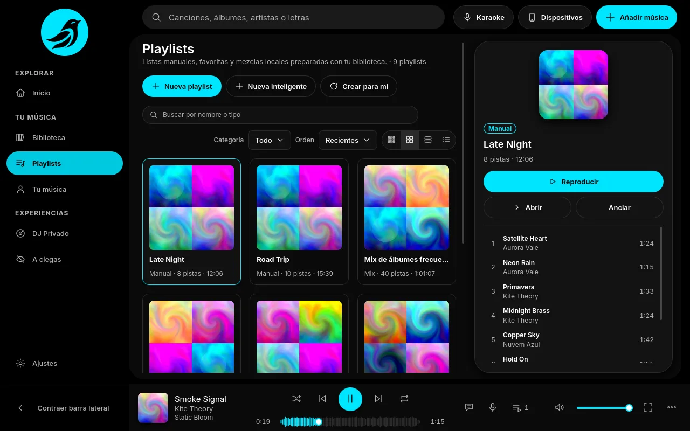 | 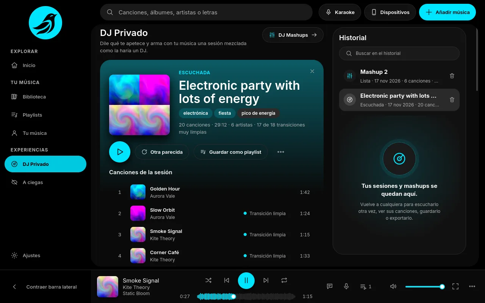 |

| DJ Mashups | Tu música | Karaoke |
|---|---|---|
| 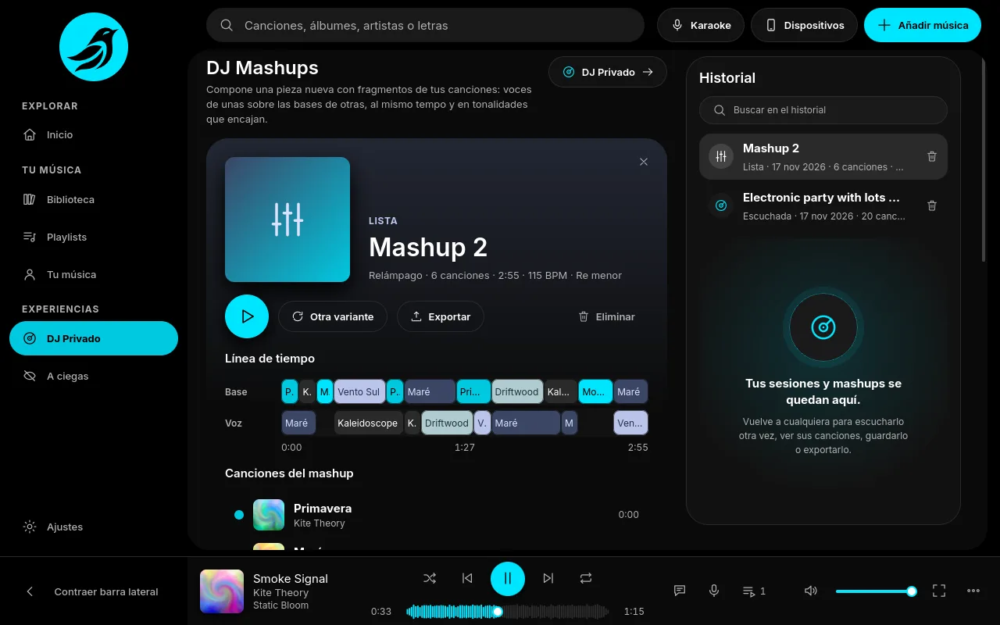 | 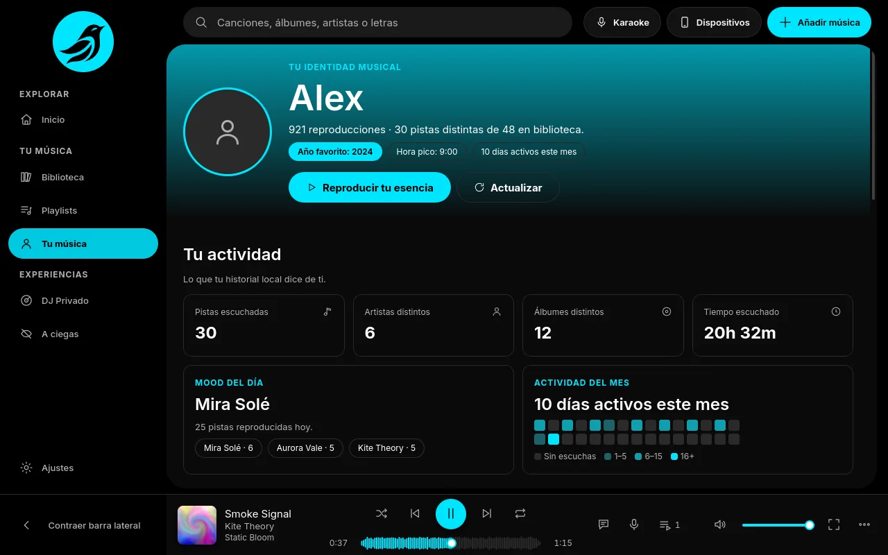 | 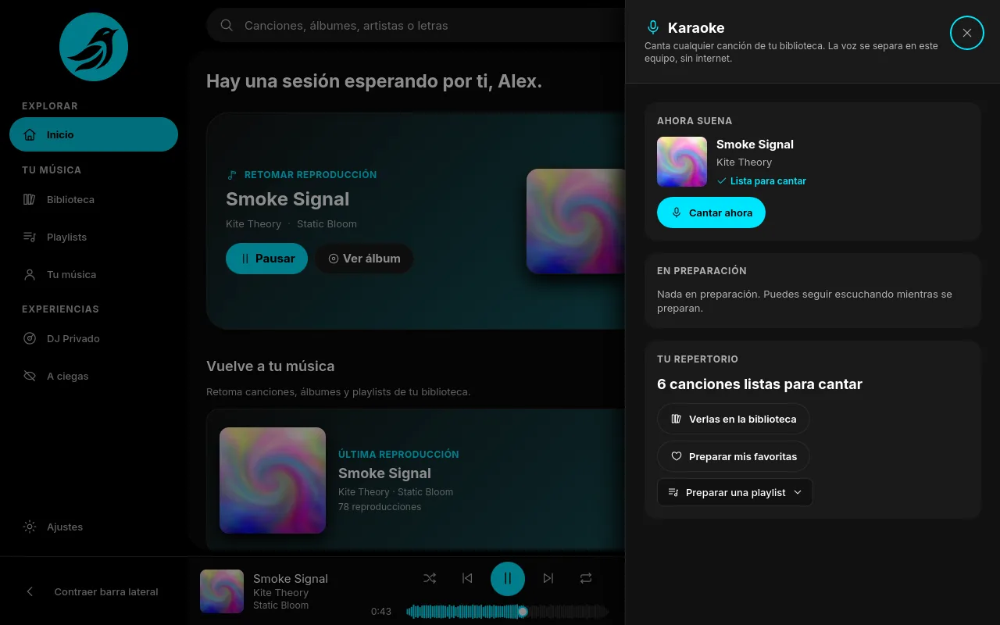 |

| Ajustes | A ciegas | |
|---|---|---|
| 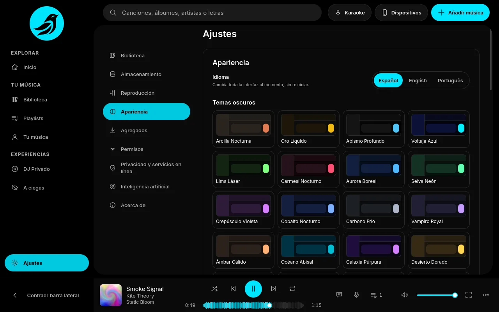 | 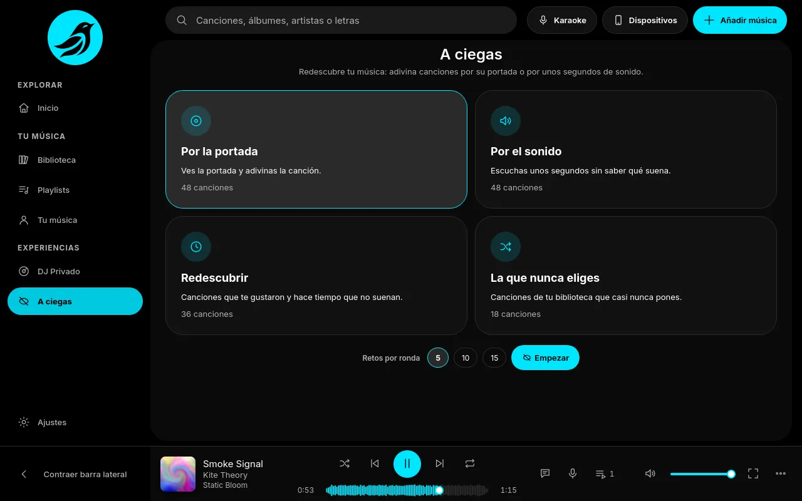 | |

La música, las portadas y los nombres de estas imágenes se generaron para la demostración; no son de nadie.

## Instalación

Descarga el paquete de tu sistema desde la [página de publicaciones](https://github.com/nb-digital-hq/nb-sound/releases)
y verifícalo con `SHA256SUMS` y su firma Ed25519 `SHA256SUMS.sig` ([cómo](docs/developer/releases.md#verificar-una-descarga)).
Los detalles por sistema están en [instalación](docs/user/installation.md).

Linux es la plataforma verificada. Windows y macOS se publican **sin haberse probado en un equipo real**. No llevan
firma de Microsoft ni de Apple: Windows muestra el aviso de SmartScreen y macOS pide autorizar la aplicación la
primera vez. Los informes desde esas plataformas son bienvenidos.

Para compilarlo: [puesta en marcha](docs/developer/setup.md).

## Documentación

| Si quieres... | Lee |
|---|---|
| Usar la aplicación | [Guía de uso](docs/user/README.md) |
| Entender cómo está hecha | [Arquitectura](docs/architecture/README.md) |
| Saber por qué está hecha así | [ADR](docs/adr/README.md) |
| Evaluarla para una institución | [Instituciones](docs/institution/README.md) |
| Contribuir | [CONTRIBUTING.md](CONTRIBUTING.md) y la [guía de desarrollo](docs/developer/README.md) |
| Trabajar en ella con un agente de IA | [AGENTS.md](AGENTS.md) |

## Licencia

NB Sound se publica bajo la licencia Apache 2.0. Ver [LICENSE](LICENSE), [NOTICE](NOTICE) y
[THIRD-PARTY-NOTICES.md](THIRD-PARTY-NOTICES.md). Los modelos que se
descargan como agregados conservan sus propias licencias ([licencias de los modelos](docs/legal/model-licenses.md)).
"NB", "NB Digital" y "NB Sound" son marcas de NB Digital ([marcas](docs/legal/trademark.md)).
