# NB Sound

<p align="center">
  
</p>

<p align="center">
  <strong>Your own music, played, organised and remixed. On your machine, and nowhere else.</strong>
</p>

<p align="center">
  
  
  
  
  
  
</p>

<p align="center">
  <strong>English</strong> · <a href="README.es.md">Español</a>
</p>

---

## TL;DR

NB Sound is a free, open-source desktop music player for the music you already own. It catalogues your files on its
own, fills in covers and lyrics, plays them gapless with loudness normalisation, and gives you what no streaming
service does with your own library: a private DJ that really mixes, karaoke of any song, a mashup composer, a game to
rediscover your music and a phone app that carries everything without internet. It works **fully offline**, needs
**no account**, and sends **nothing** anywhere unless you switch on a specific service. It is part of the NB Digital
suite.

## Features

| Area | What you get |
|---|---|
| **Playback** | Own audio engine: gapless, EBU R128 loudness, 10-band equaliser with 18 presets, waveform seek bar, synced lyrics, full screen, mini player, system media controls |
| **Library** | MP3, FLAC, M4A, OGG Vorbis and WAV; automatic identification, tagging and organisation without ever converting a file; covers, lyrics and artist images; duplicates set aside; watched folder; a review queue for anything uncertain |
| **Playlists** | Manual, rule-based smart playlists and playlists made for you from what you listen to |
| **Your Music** | Your musical identity, activity, tops and a local listening summary exportable as a card |
| **Private DJ** | A mixed session from a sentence ("calm music to focus, no reggaeton"), in English, Spanish or Portuguese, with five transition techniques |
| **DJ Mashups** | An offline composer that builds new pieces from fragments of your songs, in tempo and in key, reproducible and exportable to WAV |
| **Karaoke** | Vocal separation of any song on your own computer |
| **Blind Test** | Guess your songs by their cover or by a few seconds of sound |
| **Devices** | NB Sound Mobile sync and remote control over your local network; copy to a card or USB drive; Party Mode for guests' suggestions from their browser |
| **Add-ons** | One-click downloads from Settings: karaoke, music analysis, DJ requests in your own words, GPU acceleration (Linux with NVIDIA) |
| **Interface** | Spanish, English and Portuguese, switched instantly; 63 themes, five typefaces, six sizes |

## Privacy guarantees

Enforced by code and by automated checks, not by promises. The full statement is in [PRIVACY.md](PRIVACY.md).

* **Zero telemetry.** No analytics, no crash reporting, no usage tracking. Logs stay on your disk and never contain
  paths, titles, artists or keys.
* **One network gate.** Every outgoing connection passes through a single module with a global switch and per-service
  consent; any network client outside it fails the build checks.
* **No account.** Every feature works without signing in.
* **Your secrets in your keyring.** Optional API keys live in the operating system's keyring.

## Architecture at a glance

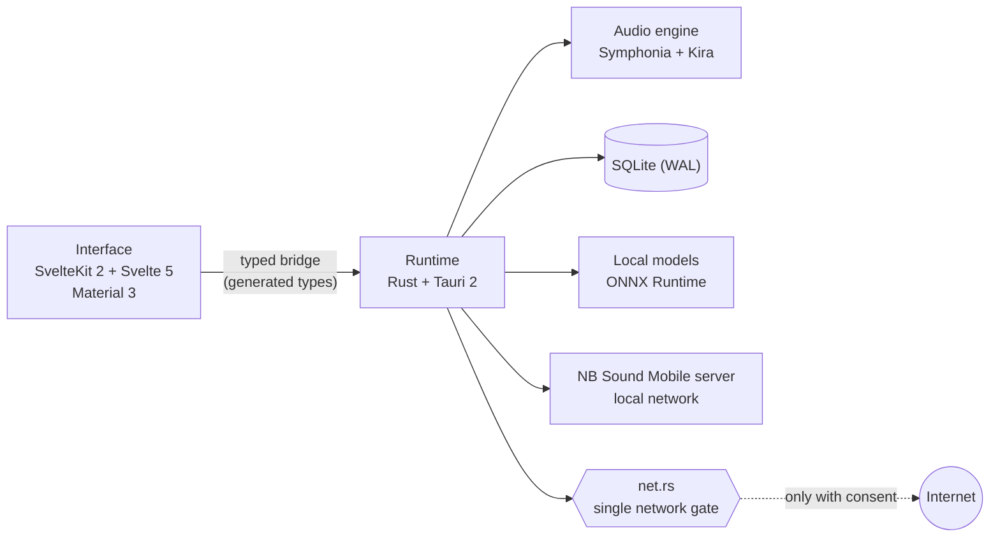

More detail in [docs/architecture](docs/architecture/README.md) (Spanish).

## Screenshots and video

[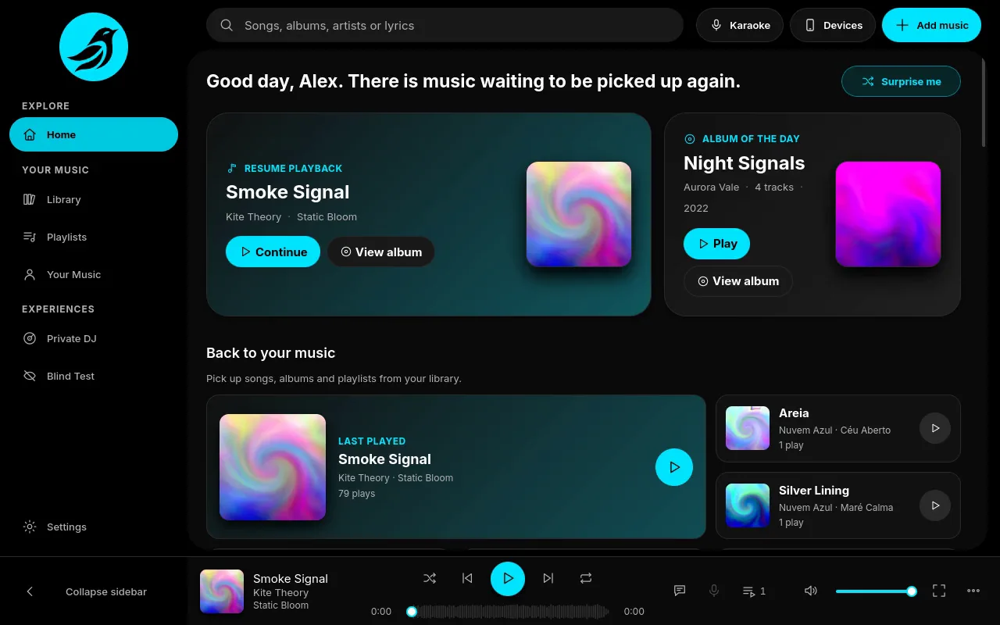](docs/assets/video/nb-sound-demo.mp4)

*A short tour recorded from the real application ([MP4](docs/assets/video/nb-sound-demo.mp4)).*

| Home | Library | Album |
|---|---|---|
| 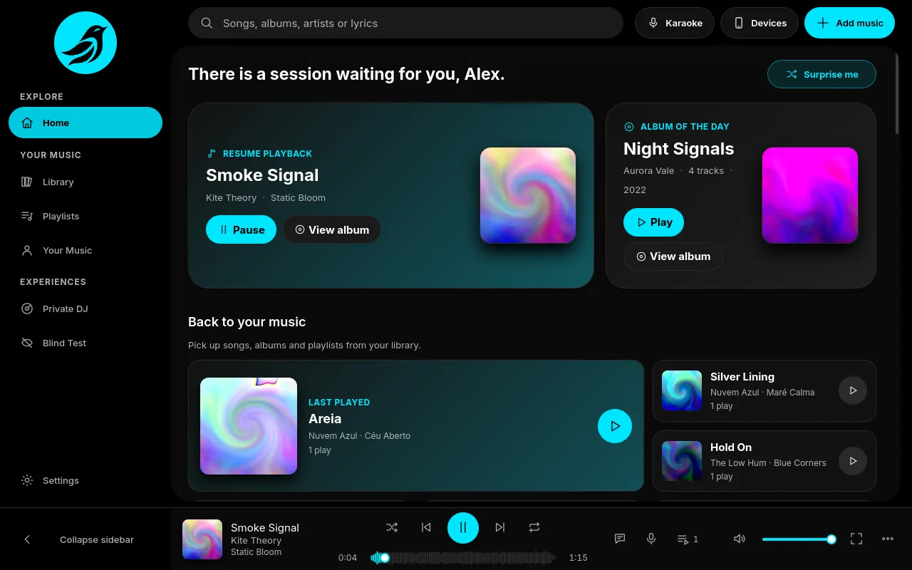 | 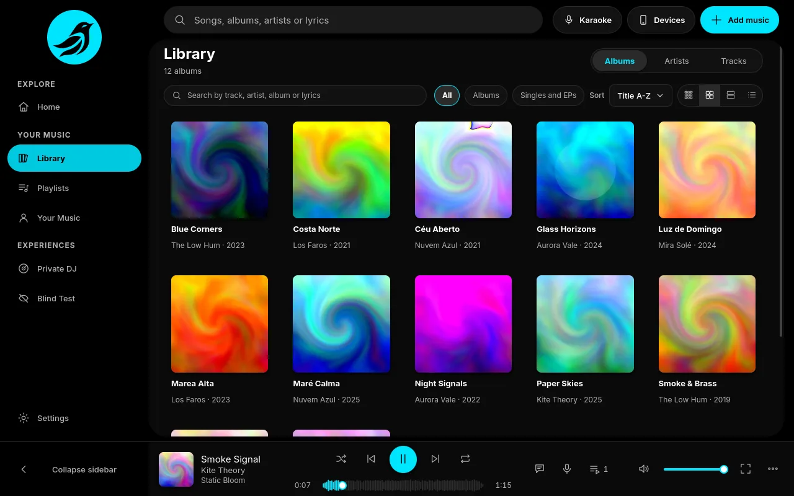 | 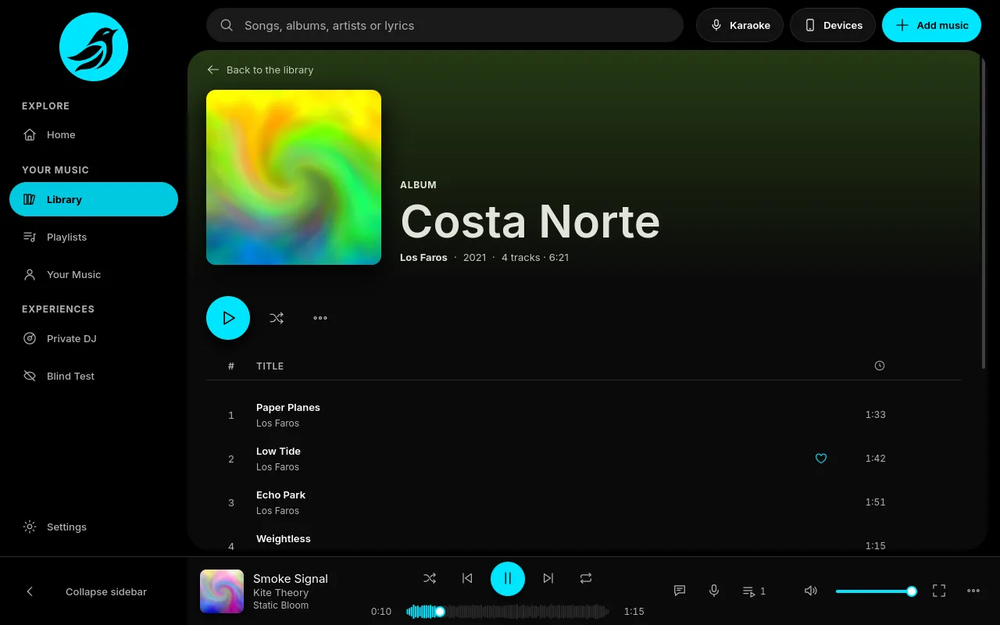 |

| Now playing | Playlists | Private DJ |
|---|---|---|
| 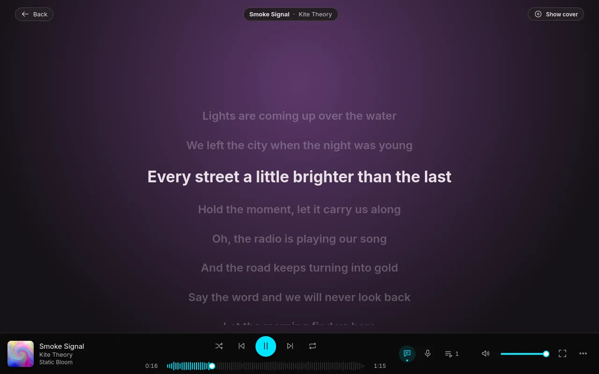 | 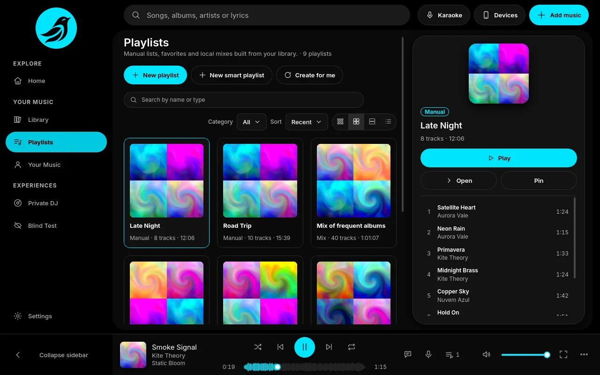 | 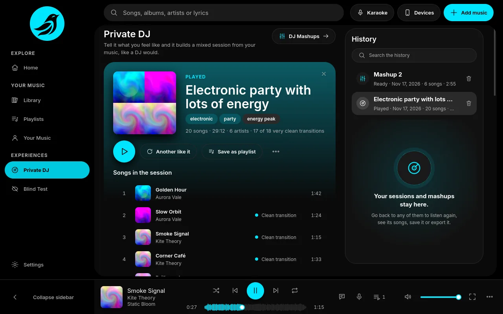 |

| DJ Mashups | Your Music | Karaoke |
|---|---|---|
| 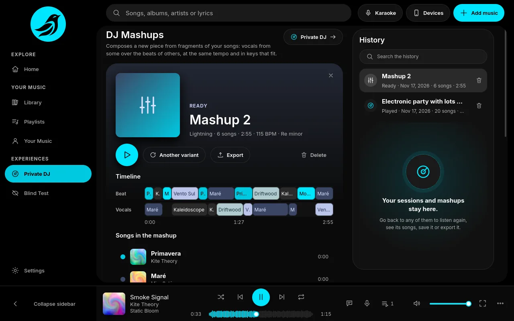 | 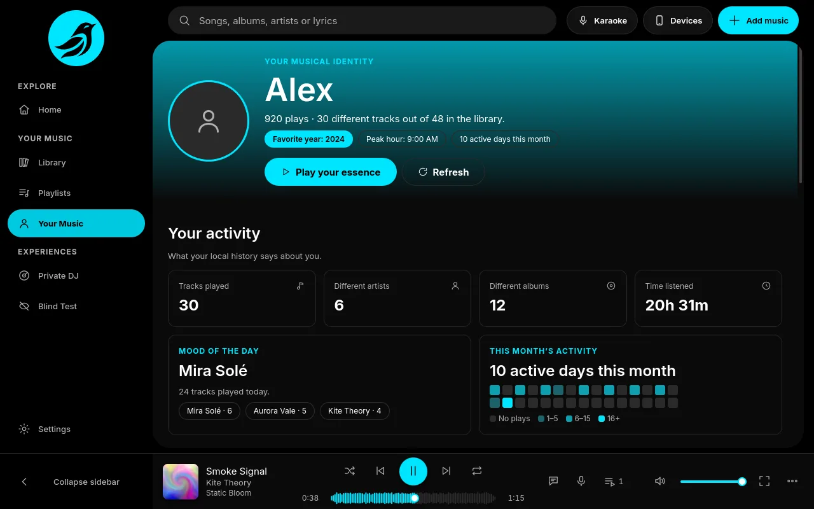 | 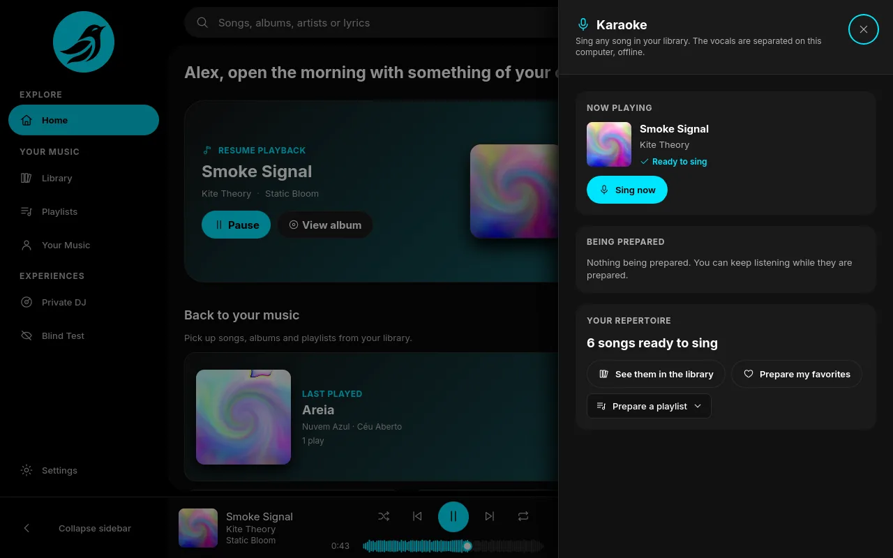 |

| Settings | Blind Test | |
|---|---|---|
| 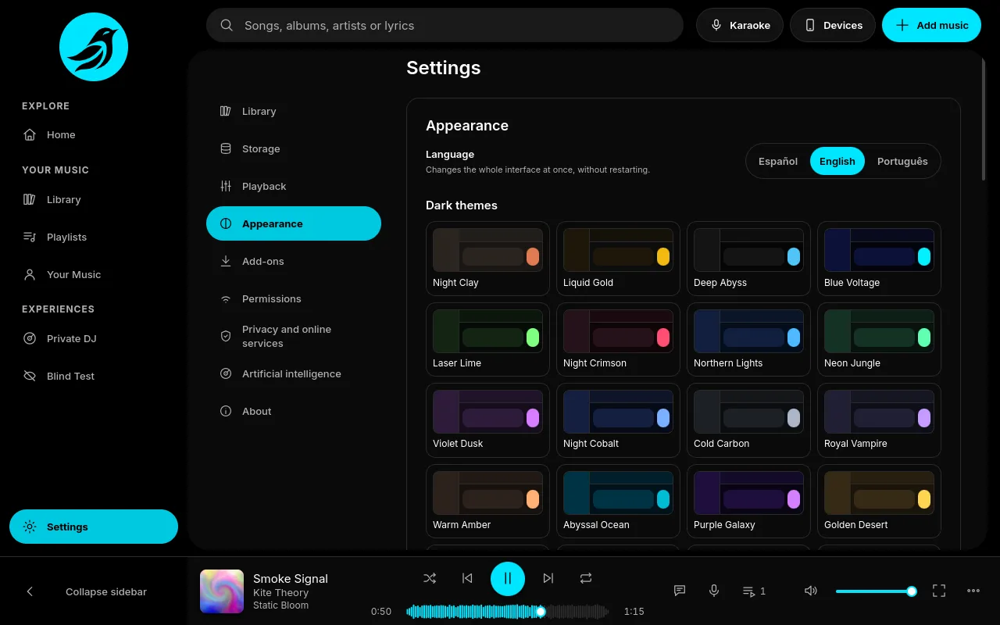 | 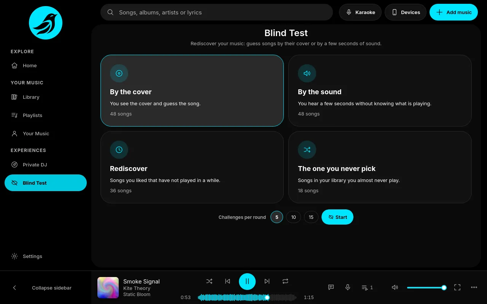 | |

The music, covers and names in these images were generated for the demonstration; they belong to no one.

## Quick install

Download the package for your system from the [release page](https://github.com/nb-digital-hq/nb-sound/releases)
and verify it against `SHA256SUMS` and its Ed25519 signature `SHA256SUMS.sig`
([how](docs/developer/releases.md#verificar-una-descarga)).

| System | Package |
|---|---|
| Debian, Ubuntu and derivatives | `.deb` |
| Fedora, openSUSE and derivatives | `.rpm` |
| Arch and any other distribution | `.tar.gz` (uses the system WebKitGTK) |
| Portable, no installation | AppImage |
| Windows 10 and 11 | `-setup.exe` or `.msi` |
| macOS on Apple Silicon | `.dmg` |

Linux is the verified platform. Windows and macOS are published **untested on real hardware**. They carry no
Microsoft or Apple signature, so Windows shows a SmartScreen warning and macOS asks you to allow the app the first
time. Reports from those platforms are welcome.

To build from source:

```bash
pnpm install && pnpm binarios && pnpm build
pnpm tauri dev
```

Requirements and details: [developer setup](docs/developer/setup.md) (Spanish).

## Documentation

| If you want to... | Read |
|---|---|
| Use the application | [User guide](docs/user/README.md) |
| Understand how it is built | [Architecture](docs/architecture/README.md) |
| Know why it is built this way | [ADR](docs/adr/README.md) |
| Evaluate it for an institution | [Institution](docs/institution/README.md) |
| Contribute | [CONTRIBUTING.md](CONTRIBUTING.md) and [developer guide](docs/developer/README.md) |
| Work on it with an AI agent | [AGENTS.md](AGENTS.md) |

## Licence

NB Sound is released under the Apache License 2.0. See [LICENSE](LICENSE), [NOTICE](NOTICE) and [THIRD-PARTY-NOTICES.md](THIRD-PARTY-NOTICES.md). The models downloaded
as add-ons keep their own licences ([model licences](docs/legal/model-licenses.md)). "NB", "NB Digital" and
"NB Sound" are trademarks of NB Digital ([TRADEMARKS.md](TRADEMARKS.md)).
