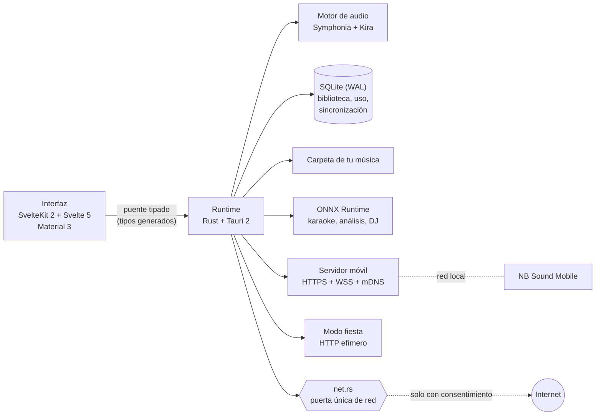

# Visión general del sistema

> **Estado:** Implementado.

NB Sound es una sola aplicación de escritorio: una interfaz web (SvelteKit en el webview del sistema) y un runtime
en Rust (Tauri 2) que es dueño del audio, de los datos y de la red.

## Las piezas

| Pieza | Dónde | Responsabilidad |
|---|---|---|
| Interfaz | `src/` | Vistas, componentes y estado de la pantalla. No reproduce audio ni toca archivos |
| Acceso al puente | `src/lib/core/ipc/` | El único sitio que llama al runtime (lint `noRestrictedImports`) |
| Tipos del puente | `src/lib/bindings/` | Generados con `ts-rs` desde Rust; nunca se editan a mano |
| Textos | `src/lib/i18n/` | Diccionarios en español, inglés y portugués ([i18n](i18n.md)) |
| Comandos | `src-tauri/src/comandos.rs` | La superficie del puente; ninguno es síncrono |
| Reproductor | `src-tauri/src/reproductor/`, `audio/`, `cola.rs` | La sesión de reproducción y el motor ([motor de audio](audio-engine.md)) |
| Datos | `src-tauri/src/db/`, `migrations/` | La base y su esquema ([almacenamiento](storage.md)) |
| Catalogación | `src-tauri/src/catalogo/` | Importar, identificar, etiquetar, organizar ([catalogación](catalog.md)) |
| Análisis | `rasgos.rs`, `analisis.rs`, `medicion.rs` | Rasgos básicos, ánimo y estilo, sonoridad y forma de onda |
| Karaoke | `karaoke.rs`, `onnx.rs` | Separación con `htdemucs` y la cola de preparación |
| DJ | `src-tauri/src/dj/` | El DJ Privado ([DJ](dj.md)) |
| Mashups | `src-tauri/src/mashup/` | DJ Mashups ([mashups](mashups.md)) |
| Teléfono | `src-tauri/src/movil/` | El servidor del contrato móvil ([contrato móvil](mobile-contract.md)) |
| Modo fiesta | `fiesta.rs` | El servidor efímero para invitados ([ADR-012](../adr/012-party-mode.md)) |
| Agregados | `agregados.rs`, `gpu.rs` | Descarga, verificación e instalación de los modelos ([ADR-006](../adr/006-add-ons.md)) |
| Red | `net.rs`, `privacidad.rs` | La puerta única y el consentimiento por servicio ([red](network.md)) |
| Secretos | `secrets.rs` | El llavero del sistema |
| Registro | `telemetry.rs` | Registro local con redacción obligatoria; no envía nada |
| NB Launcher | `enlace_launcher/`, `autorizacion_launcher/`, `frecuencia_compartida.rs`, `instalacion_administrada.rs` | [Integración con NB Launcher](launcher-integration.md) |
| Idioma del runtime | `idioma.rs` | Lo que nombra el runtime, en el idioma de la interfaz |

## Hilos

El audio corre en su propio hilo de tiempo real. La importación, el karaoke, el análisis, la sonoridad, los mashups,
la copia automática y lo que se completa en segundo plano tienen cada uno su hilo, a la prioridad más baja del sistema
para el procesador y, en Linux y Windows, también para el disco (`prioridad.rs`): solo usan lo que el equipo no está
usando. Ningún comando del puente corre en el hilo de la ventana (`check-comandos`).

## Lo que se garantiza

* Un fallo de una pieza no tira las demás ([Constitución](constitution.md), regla 6).
* Nada sale a la red sin pasar por `net.rs` ([red](network.md)).
* Ningún registro contiene rutas, títulos, artistas ni claves ([privacidad](../audit/privacy.md)).
