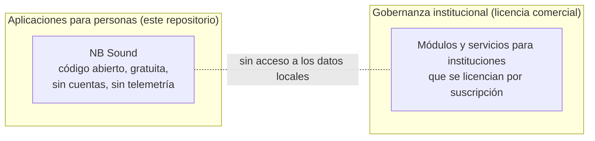

# NB Sound para instituciones

> **Estado:** Aplicable. **Audiencia:** dirección, áreas de tecnología, jurídicas y de cumplimiento.

NB Sound es una aplicación para personas: un reproductor y catalogador de la música propia que funciona por completo
en el equipo de quien lo usa. Esta sección explica qué puede afirmar una institución que lo adopta y cómo se relaciona
con la oferta institucional de NB Digital.

## Lo que la aplicación es

* **Completa y gratuita para la persona.** Ninguna función se reserva a una edición de pago.
* **Local.** Sin cuentas, sin servidores de NB Digital y sin telemetría. La biblioteca, el historial y los ajustes
  viven en el equipo ([privacidad](../audit/privacy.md)).
* **Sin salidas a internet por defecto que no se puedan apagar.** Un interruptor general y uno por servicio
  ([red](../architecture/network.md)).

## Dos modelos sobre la misma base

* **Las aplicaciones para personas son de código abierto.** NB Sound es una de ellas
  ([licencias](../legal/licensing.md)).
* **Los módulos y servicios de gobernanza para instituciones son de pago**, con una licencia comercial institucional
  por suscripción, y no forman parte de este repositorio.
* **La frontera es técnica.** NB Sound no depende de ningún componente comercial, no envía a ninguna institución su
  biblioteca, su historial ni su actividad, y funciona igual exista o no una oferta institucional.

Hoy NB Digital no ofrece ningún módulo institucional para NB Sound. Cuando exista, se licenciará aparte y se integrará
por un contrato publicado, sin cambiar esta aplicación ni su licencia.

## Despliegue en equipos gestionados

* **Linux:** `.deb` y `.rpm` para el gestor de paquetes de la flota; el `.tar.gz` para distribuciones sin ellos.
* **Windows:** `.msi` para instalación desatendida (`msiexec /i ... /qn`).
* **macOS:** `.dmg`.
* Las actualizaciones automáticas solo ocurren si alguien pulsa "Buscar actualizaciones" con los servicios en línea
  encendidos; una flota puede gestionar las versiones con sus propias herramientas.

Windows y macOS se publican sin haberse probado en un equipo real ([empaquetado](../developer/packaging.md)).
